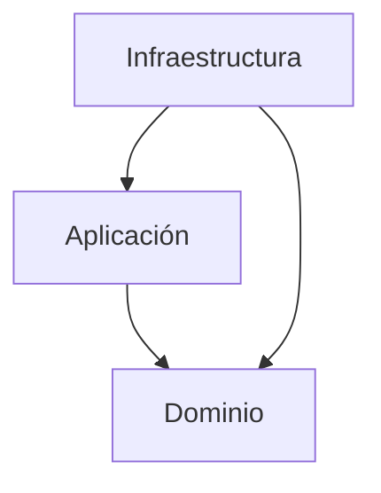

# Smart Help Desk API
API empresarial para administrar solicitudes
de soporte técnico.
## Tecnologías
- Java 21
- Spring Boot 3.5.16
- Gradle 8.14.3
- Spring Web
- Spring Validation
- JUnit 5
## Arquitectura hexagonal
El proyecto utiliza arquitectura hexagonal
para separar las reglas de negocio
de los detalles de infraestructura.
### Domain
Contiene las reglas de negocio,
objetos de valor, modelos y contratos.
No depende de Spring Boot ni de JPA.
### Application
Contiene los casos de uso que coordinan
las operaciones del sistema.
### Infrastructure
Contiene la configuración de Spring Boot
y los futuros adaptadores HTTP y de persistencia.
### Shared
Contendrá elementos técnicos compartidos.
## Dirección de dependencias
Infrastructure -> Application -> Domain
Las capas internas no deben depender
de las implementaciones externas.
## Día 1
Se implementaron:
- Estructura inicial del proyecto.
- Arquitectura hexagonal.
- InvalidValueException.
- EmailAddress.
- FullName.
- Pruebas unitarias con JUnit 5.
## Pruebas
Ejecutar en Windows:
.\gradlew.bat clean test
Resultado verificado:
9 pruebas exitosas y 0 fallidas.
## Ejecución
Ejecutar la clase:
SmarthelpdeskApplication
Servidor local:
http://localhost:8080

## Diagrama de arquitectura

La infraestructura contiene los adaptadores
y la configuración técnica.
La aplicación coordina los casos de uso.
El dominio contiene las reglas del negocio
y no depende de Spring Boot ni de JPA.

## Día 2 - Modelado orientado a objetos

Se implementó el agregado Ticket utilizando

encapsulamiento y comportamiento de dominio.

### Clases y objetos de valor

- Ticket

- TicketId

- UserId

- CategoryId

- TicketStatus

- TicketPriority

### Reglas de negocio

- Un ticket se crea en estado OPEN.

- El ticket tiene identidad única mediante UUID.

- El asunto y la descripción son obligatorios.

- La prioridad no puede ser nula.

- No se permite modificar un ticket cerrado.

- Los cambios actualizan updatedAt.

- createdAt permanece inmutable.

### Decisiones de diseño

Ticket es una entidad y utiliza una clase final

porque tiene identidad y estado que puede cambiar.

TicketId es un objeto de valor implementado

mediante record porque es inmutable.

Se evitan setters públicos para proteger

las invariantes del dominio.

### Pruebas

Ejecutar:

.\gradlew.bat clean test

## Día 3 - Usuarios, colecciones y repositorios en memoria

### Implementaciones

- Entidad User.

- Enum RoleName.

- Gestión de roles mediante Set.

- Activación y desactivación de usuarios.

- UserRepositoryPort.

- InMemoryUserRepositoryAdapter.

- Entidad Category.

- CategoryRepositoryPort.

- InMemoryCategoryRepositoryAdapter.

### Decisiones técnicas

Se utiliza Set para evitar roles duplicados.

Se utiliza ConcurrentHashMap para almacenar

usuarios y categorías temporalmente.

Los puertos definen contratos independientes

de la tecnología de persistencia.

Los adaptadores implementan esos contratos.

Los nombres de categorías se comparan

sin distinguir mayúsculas y minúsculas.

### Pruebas

35 pruebas ejecutadas correctamente.

0 pruebas fallidas.

Comando:

.\gradlew.bat clean test

## Día 4 - Streams, Optional y Dashboard
### Objetivo
Implementar consultas y estadísticas sobre los tickets
utilizando Java Streams y arquitectura hexagonal.
### Componentes desarrollados
- TicketRepositoryPort
- InMemoryTicketRepositoryAdapter
- DashboardSummary
- GetDashboardSummaryUseCase
- DashboardConfig
### Funcionalidades
- Guardar y consultar tickets en memoria.
- Buscar tickets mediante Optional.
- Agrupar tickets por estado.
- Agrupar tickets por prioridad.
- Contar tickets utilizando Streams.
- Calcular el porcentaje de tickets cerrados.
- Evitar la división por cero.
- Configurar dependencias mediante Spring Beans.
### Conceptos aplicados
- Stream API
- filter()
- count()
- Collectors.groupingBy()
- Collectors.counting()
- Optional
- Records
- Inyección de dependencias
- Inversión de dependencias (SOLID)
### Pruebas
44 pruebas exitosas.
0 pruebas fallidas.
0 pruebas omitidas.
Comando de ejecución:
.\gradlew.bat clean test
### Ejecución
La aplicación inicia correctamente
utilizando Spring Boot y Tomcat en el puerto 8080.

# Día 5 — Implementación de casos de uso

## Objetivo

Implementar los casos de uso de Smart Help Desk siguiendo

los principios de arquitectura hexagonal, separando la

lógica de aplicación del dominio y la infraestructura.

## Funcionalidades implementadas

### 1. Registro de usuarios

Clases desarrolladas:

- `CreateUserCommand`

- `CreateUserResult`

- `CreateUserUseCase`

- `CreateUserService`

El servicio permite:

- Registrar usuarios con nombre y correo electrónico.

- Validar los datos mediante objetos de valor.

- Generar identificadores UUID.

- Asignar automáticamente el rol `USER`.

- Evitar el registro de correos duplicados.

- Guardar usuarios mediante `UserRepositoryPort`.

### 2. Creación de tickets

Clases desarrolladas:

- `CreateTicketCommand`

- `CreateTicketResult`

- `CreateTicketUseCase`

- `CreateTicketService`

El servicio permite:

- Comprobar que el usuario solicitante exista.

- Verificar que la categoría exista.

- Validar asunto, descripción y prioridad.

- Crear tickets mediante `Ticket.open()`.

- Generar identificadores UUID.

- Guardar tickets mediante `TicketRepositoryPort`.

- Crear tickets inicialmente en estado `OPEN`.

### 3. Consulta de tickets

Clases desarrolladas:

- `GetTicketByIdUseCase`

- `GetTicketByIdService`

Funcionalidades:

- Consultar tickets por UUID.

- Validar identificadores nulos.

- Buscar tickets mediante `TicketRepositoryPort`.

- Lanzar `ResourceNotFoundException` cuando

  el ticket no existe.

## Reglas de negocio

- No se permiten correos electrónicos duplicados.

- Los correos deben tener un formato válido.

- No se aceptan solicitudes nulas.

- Un ticket debe pertenecer a un usuario existente.

- Un ticket debe tener una categoría válida.

- El asunto y la descripción son obligatorios.

- La prioridad no puede ser nula.

- Los tickets nuevos comienzan en estado `OPEN`.

## Arquitectura hexagonal

Los casos de uso dependen de interfaces que representan

puertos de salida.

Ejemplo:

    CreateTicketService

            |

            v

    TicketRepositoryPort

            |

            v

    InMemoryTicketRepositoryAdapter

Esta estructura permite sustituir los adaptadores de

persistencia sin modificar necesariamente los casos

de uso.

## Principios SOLID aplicados

### SRP — Principio de responsabilidad única

Cada servicio tiene una responsabilidad principal:

- `CreateUserService`: registrar usuarios.

- `CreateTicketService`: crear tickets.

- `GetTicketByIdService`: consultar tickets.

### DIP — Principio de inversión de dependencias

Los servicios dependen de abstracciones como

`UserRepositoryPort`, `CategoryRepositoryPort`

y `TicketRepositoryPort`, en lugar de depender

directamente de implementaciones en memoria.

### OCP — Principio abierto/cerrado

El uso de interfaces facilita incorporar nuevas

implementaciones de persistencia manteniendo

los contratos existentes.

## Pruebas unitarias

Se implementaron pruebas con JUnit 5.

### CreateUserServiceTest

- Registro exitoso.

- Rechazo de correos duplicados.

- Rechazo de correos inválidos.

- Rechazo de solicitudes nulas.

### CreateTicketServiceTest

- Creación exitosa de tickets.

- Rechazo de usuarios inexistentes.

- Rechazo de categorías inexistentes.

- Rechazo de solicitudes nulas.

- Rechazo de asuntos vacíos.

- Rechazo de descripciones vacías.

- Rechazo de prioridades nulas.

### GetTicketByIdServiceTest

- Consulta de tickets existentes.

- Rechazo de tickets inexistentes.

- Rechazo de identificadores nulos.

## Ejecución de pruebas

En Windows:

    .\gradlew.bat clean test

Resultado obtenido:

    BUILD SUCCESSFUL

## Resultado del Día 5

Se completó la implementación de los principales

casos de uso de usuarios y tickets.

La lógica de aplicación quedó separada de los

adaptadores de persistencia y respaldada por

pruebas unitarias.

# Día 6 — Desarrollo de API REST con Spring Boot

## Objetivo

Exponer los casos de uso de Smart Help Desk mediante

endpoints REST, implementar el manejo centralizado

de excepciones y automatizar pruebas de controladores.

## Tecnologías utilizadas

- Java 21.

- Spring Boot 3.5.16.

- Spring Web.

- Gradle.

- JUnit 5.

- Mockito.

- MockMvc.

- Postman.

## Configuración de Spring Boot

Se registraron los servicios de aplicación mediante

la anotación `@Service`.

Servicios configurados:

- `CreateUserService`

- `CreateTicketService`

- `GetTicketByIdService`

Los repositorios en memoria se registraron como

Beans mediante la configuración de Spring.

### Configuración del servidor

Archivo:

`src/main/resources/application.properties`

Configuración:

    spring.application.name=smarthelpdesk

    server.port=8081

URL base:

`http://localhost:8081`

## Controladores REST

### UserController

Permite registrar usuarios mediante solicitudes HTTP.

**POST /api/users**

Request:

    {

      "fullName": "Ana Maria Lopez",

      "email": "ana@example.com"

    }

Respuesta exitosa: `201 Created`.

    {

      "id": "550e8400-e29b-41d4-a716-446655440000",

      "fullName": "Ana Maria Lopez",

      "email": "ana@example.com"

    }

El UUID se genera automáticamente.

### TicketController

Permite crear y consultar tickets de soporte.

**POST /api/tickets**

Request:

    {

      "userId": "UUID_DEL_USUARIO",

      "categoryId": "UUID_DE_LA_CATEGORIA",

      "subject": "Computador no enciende",

      "description": "El computador no responde",

      "priority": "HIGH"

    }

Respuesta exitosa: `201 Created`.

    {

      "id": "550e8400-e29b-41d4-a716-446655440001",

      "subject": "Computador no enciende",

      "status": "OPEN"

    }

**GET /api/tickets/{id}**

Permite consultar un ticket existente mediante UUID.

Respuesta exitosa: `200 OK`.

    {

      "id": "550e8400-e29b-41d4-a716-446655440001",

      "requesterId": "550e8400-e29b-41d4-a716-446655440000",

      "categoryId": "550e8400-e29b-41d4-a716-446655440002",

      "subject": "Computador no enciende",

      "description": "El computador no responde",

      "priority": "HIGH",

      "status": "OPEN"

    }

Los UUID anteriores son valores de ejemplo.

## Endpoints disponibles

| Método | Endpoint | Respuesta |

|--------|----------|-----------|

| POST | `/api/users` | 201 Created |

| POST | `/api/tickets` | 201 Created |

| GET | `/api/tickets/{id}` | 200 OK |

## Manejo centralizado de excepciones

Se implementó `GlobalExceptionHandler` utilizando

las anotaciones `@RestControllerAdvice`

y `@ExceptionHandler`.

Permite transformar excepciones del dominio

y la aplicación en respuestas HTTP.

| Situación | Código HTTP |

|-----------|-------------|

| Datos inválidos | 400 Bad Request |

| Recurso inexistente | 404 Not Found |

| Correo duplicado | 409 Conflict |

### Ejemplo: correo duplicado

    {

      "error": "Conflict",

      "message": "A user with this email already exists"

    }

### Ejemplo: correo inválido

    {

      "error": "Bad Request",

      "message": "Email format is invalid"

    }

### Ejemplo: ticket inexistente

    {

      "error": "Not Found",

      "message": "Ticket not found"

    }

## Implementación de DTO

Se creó `TicketResponse` para separar la entidad

de dominio de los datos expuestos mediante la API.

Antes:

    {

      "id": {

        "value": "550e8400-e29b-41d4-a716-446655440001"

      }

    }

Después:

    {

      "id": "550e8400-e29b-41d4-a716-446655440001"

    }

Beneficios:

- Evitar exponer directamente la entidad de dominio.

- Simplificar las respuestas JSON.

- Reducir el acoplamiento entre dominio e infraestructura.

- Controlar los datos enviados a los clientes HTTP.

## Inicialización de categorías

Se implementó `CategoryDataInitializer` utilizando

`CommandLineRunner`.

Al iniciar Spring Boot:

1. Se crea automáticamente la categoría Hardware.

2. Se guarda mediante `CategoryRepositoryPort`.

3. Se genera un identificador UUID.

4. El UUID se muestra en la terminal.

Esto facilita las pruebas de creación de tickets.

## Arquitectura de la API REST

Flujo de ejecución:

    Cliente HTTP / Postman

              |

              v

        REST Controller

              |

              v

        UseCase Interface

              |

              v

        UseCase Service

              |

              v

        Repository Port

              |

              v

      InMemory Repository Adapter

### Responsabilidades

**Dominio**

Contiene entidades, objetos de valor y contratos

de repositorio.

**Aplicación**

Contiene los casos de uso que coordinan las

operaciones del sistema.

**Infraestructura**

Contiene los controladores REST, configuración

de Spring Boot, adaptadores de persistencia,

DTOs HTTP y manejo de excepciones.

## Pruebas automatizadas

Se implementó `TicketControllerTest`

utilizando JUnit 5, Mockito y MockMvc.

### Pruebas implementadas

**shouldReturn404WhenTicketDoesNotExist**

Comprueba que una consulta de un ticket inexistente

devuelva HTTP 404 y el mensaje correspondiente.

**shouldReturn200WhenTicketExists**

Comprueba que una consulta válida devuelva HTTP 200

con los datos del ticket mediante `TicketResponse`.

**shouldReturn201WhenTicketIsCreated**

Comprueba que una solicitud POST devuelva HTTP 201,

los datos esperados y que se invoque el caso de uso.

### Herramientas

**Mockito**

Permite simular dependencias sin ejecutar

sus implementaciones reales.

**MockMvc**

Permite simular solicitudes HTTP y verificar

las respuestas de los controladores sin

iniciar un servidor web.

## Pruebas manuales con Postman

| Escenario | Resultado |

|-----------|-----------|

| Registrar usuario | 201 Created |

| Registrar correo duplicado | 409 Conflict |

| Registrar correo inválido | 400 Bad Request |

| Crear ticket | 201 Created |

| Consultar ticket existente | 200 OK |

| Consultar ticket inexistente | 404 Not Found |

Todas estas respuestas fueron comprobadas

durante las pruebas manuales.

## Persistencia actual

Se utilizan los siguientes adaptadores:

- `InMemoryUserRepositoryAdapter`

- `InMemoryCategoryRepositoryAdapter`

- `InMemoryTicketRepositoryAdapter`

Los datos se almacenan temporalmente en memoria.

Al reiniciar Spring Boot, los registros de usuarios

y tickets se pierden.

La categoría Hardware se vuelve a crear

automáticamente con un nuevo UUID.

## Ejecución del proyecto

### Requisitos

- JDK 21.

- Gradle Wrapper.

- IntelliJ IDEA o IDE compatible.

- Postman para pruebas manuales.

### Ejecutar pruebas

Windows:

    .\gradlew.bat clean test

### Iniciar aplicación

Windows:

    .\gradlew.bat bootRun

La aplicación utiliza el puerto 8081.

## Principios SOLID aplicados

### SRP — Responsabilidad única

Los controladores gestionan HTTP, los servicios

ejecutan los casos de uso y los adaptadores

implementan la persistencia.

### DIP — Inversión de dependencias

Los controladores dependen de interfaces

de casos de uso.

Los servicios dependen de puertos de repositorio.

### OCP — Abierto/cerrado

La separación mediante interfaces facilita extender

la infraestructura sin modificar la lógica de

aplicación existente.

## Resultado del Día 6

Se completó una API REST funcional con:

- Registro de usuarios.

- Creación y consulta de tickets.

- Manejo centralizado de errores HTTP.

- DTOs para respuestas JSON.

- Inyección de dependencias con Spring.

- Inicialización automática de categorías.

- Pruebas automatizadas con Mockito y MockMvc.

- Validaciones manuales con Postman.

Las pruebas finalizaron con:

    BUILD SUCCESSFUL

Día 7 - Persistencia con Spring Data JPA y H2
Objetivo

Implementar la persistencia de usuarios, categorías y tickets utilizando Spring Data JPA y H2, manteniendo la arquitectura hexagonal del proyecto.
Componentes desarrollados

UserJpaEntity

SpringDataUserRepository

JpaUserRepositoryAdapter

CategoryJpaEntity

SpringDataCategoryRepository

JpaCategoryRepositoryAdapter

TicketJpaEntity

SpringDataTicketRepository

JpaTicketRepositoryAdapter

Ticket.restore()

JpaUserRepositoryAdapterTest

JpaCategoryRepositoryAdapterTest

JpaTicketRepositoryAdapterTest
Funcionalidades

Guardar y consultar usuarios en la base de datos H2.

Conservar los roles y el estado activo de los usuarios.

Validar correos electrónicos duplicados.

Guardar y consultar categorías.

Evitar la creación de categorías duplicadas.

Inicializar automáticamente la categoría Hardware.

Guardar y recuperar tickets mediante Spring Data JPA.

Buscar tickets por identificador UUID.

Conservar la prioridad y el estado de los tickets.

Recuperar tickets cerrados sin modificar su estado.

Mantener las fechas originales de creación y actualización.

Conservar los registros después de reiniciar Spring Boot.
Pruebas realizadas

Pruebas de persistencia de usuarios en H2.

Pruebas de persistencia de categorías.

Pruebas de persistencia de tickets.

Validación de roles y estado activo.

Validación de categorías duplicadas.

Verificación de tickets abiertos y cerrados.

Verificación de fechas originales.

Prueba de creación de tickets desde Postman.

Consulta de tickets mediante GET.

Consultas SQL para verificar los datos almacenados.

Reinicio de Spring Boot para comprobar la persistencia.
Resultado del Día 7

Se implementó correctamente la persistencia de usuarios, categorías y tickets mediante Spring Data JPA y H2.

Los datos permanecen almacenados después de reiniciar la aplicación y se mantiene la separación entre dominio, aplicación e infraestructura.
Resultados obtenidos:

BUILD SUCCESSFUL.

Pruebas de integración satisfactorias.

POST /api/tickets: 201 Created.

GET /api/tickets/{id}: 200 OK.

Persistencia de tickets comprobada en H2.

Arquitectura hexagonal conservada.

0 pruebas fallidas en la ejecución completa de Gradle.


 ```